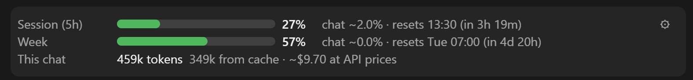

# claude-usage-bars

Always-visible usage limit bars for **Claude Code**, drawn right above the prompt — in the desktop app (Code tab) and in the terminal. No more opening the settings to check how much of your limits you have left.



*Barre sempre visibili dei limiti di utilizzo di Claude Code, sopra il prompt. Interfaccia in inglese e in italiano.*

## What it shows

- **5-hour and weekly limits**: percentage used, as a coloured bar (green / yellow / red by threshold).
- **Reset time**: exact time and countdown.
- **This chat's share**: how many points of each limit went up while this chat was working (an estimate: usage elsewhere at the same time counts too).
- **This chat's consumption**: tokens processed, cache reads, and what it would cost at API prices.
- **Forecast**: a warning when, at the current pace, you would hit the limit before it resets.
- **Alerts**: a notification when you cross the yellow and red thresholds (once per threshold, per window).

## Settings (⚙)

Click the ⚙ at the top right of the bars: colour (traffic light or a fixed colour), yellow/red thresholds, bar length, which rows to show, compact one-line mode, alerts on/off, language (English or Italian; automatic follows your system). Settings are saved and apply to every chat, separately for each place you use Claude Code: the desktop app, VS Code and the terminal each keep their own (for example, compact in VS Code and full in the desktop app).

**Hide here** turns the bars off only where you are. Type `/usage-bars` to bring them back, or to hide them without opening the panel.

## Install

At the prompt of a terminal session:

```
/plugin install usage-bars --marketplace turiddu91/claude-usage-bars
```

From a shell:

```
claude plugin install usage-bars --marketplace turiddu91/claude-usage-bars
```

In the desktop app, where `/plugin` does not run: click **+** next to the prompt box, then **Plugins**, **Add marketplace** with `turiddu91/claude-usage-bars`, then **Add plugin**.

## Notes

- Limits are only reported on a Claude subscription (Pro / Max); with an API key there are no bars, only the chat's consumption.
- Anthropic reports percentages, not absolute token totals, so the bars show percentages.
- Figures update after each Claude reply.

## License

MIT
